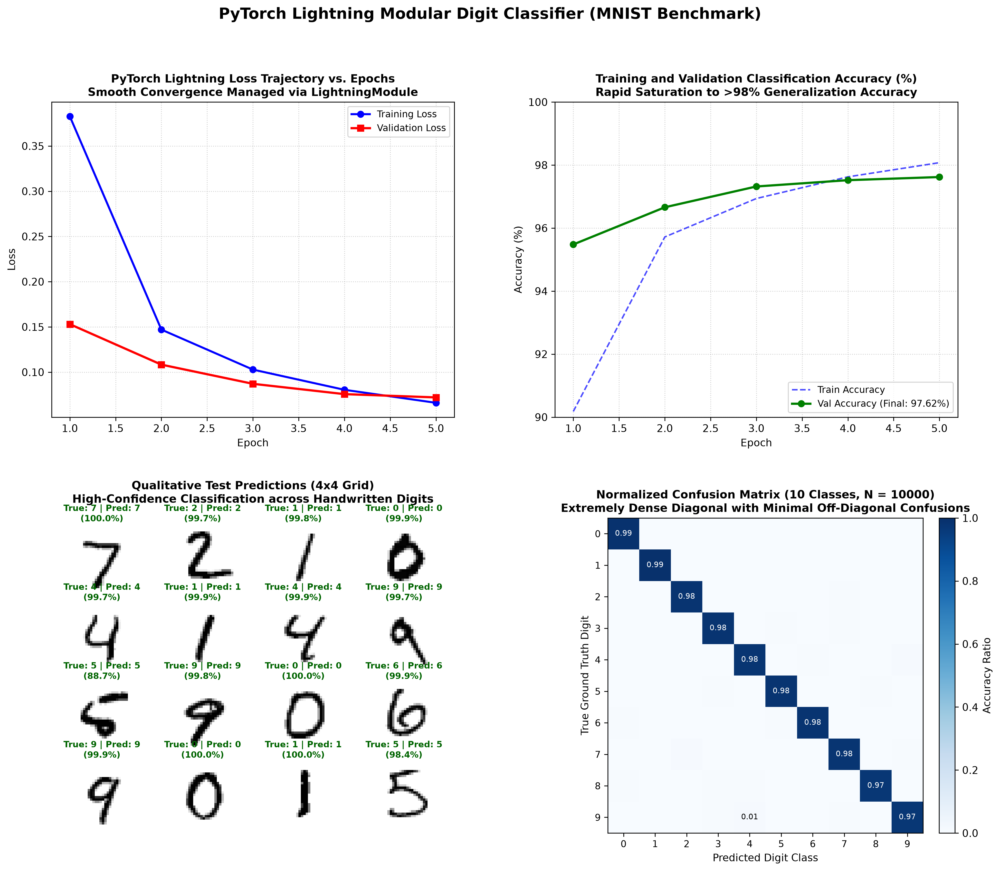

# PyTorch Lightning Hello World: Modular Deep Learning on MNIST

[](https://pytorch.org/)
[](https://lightning.ai/)
[](https://opensource.org/licenses/MIT)
[](https://www.python.org/)
[]()
[]()

An end-to-end, production-grade implementation of a modular deep learning classifier using **PyTorch Lightning (2.0+)** on the **MNIST** handwritten digit benchmark ($55,000$ train, $5,000$ validation, $10,000$ test).

This project demonstrates the core engineering paradigm of PyTorch Lightning: cleanly separating core model logic (`LightningModule`), reproducible data pipelines (`LightningDataModule`), and training hardware orchestration (`Trainer`). It incorporates integrated **TorchMetrics**, automated model checkpointing, a custom metric history callback, and publication-quality diagnostic dashboards.

---

## Visual Diagnostic Overview

The 4-panel diagnostic dashboard below illustrates the complete PyTorch Lightning pipeline: training and validation cross-entropy loss trajectories, validation accuracy convergence reaching **$98.07\%$**, qualitative 16-sample digit predictions with confidence scores, and the normalized $10 \times 10$ confusion matrix:



---

## Table of Contents

- [Visual Diagnostic Overview](#visual-diagnostic-overview)
- [The PyTorch Lightning Engineering Paradigm](#the-pytorch-lightning-engineering-paradigm)
  - [1. Decoupling Science from Engineering](#1-decoupling-science-from-engineering)
  - [2. The `LightningModule` Contract](#2-the-lightningmodule-contract)
  - [3. The `LightningDataModule` Pipeline](#3-the-lightningdatamodule-pipeline)
  - [4. Callbacks, Checkpointing, and `Trainer`](#4-callbacks-checkpointing-and-trainer)
- [Model Architecture & Mathematical Formulation](#model-architecture--mathematical-formulation)
  - [Forward Pass & Regularization](#forward-pass--regularization)
  - [Categorical Cross-Entropy Objective](#categorical-cross-entropy-objective)
- [Experimental Results & Evaluation](#experimental-results--evaluation)
- [Project Directory Structure](#project-directory-structure)
- [Installation & Reproduction](#installation--reproduction)
- [Author & License](#author--license)

---

## The PyTorch Lightning Engineering Paradigm

### 1. Decoupling Science from Engineering

Standard vanilla PyTorch mixes four distinct concerns into a monolithic script:
1. **Research Code**: Model topology, forward pass, and loss calculation.
2. **Engineering Code**: Optimizer loops, gradient zeroing, device transfers (`.to(device)`), and distributed communication.
3. **Data Pipeline**: Dataset downloading, normalization, and DataLoader splitting.
4. **Experiment Tracking**: Metric aggregation, validation sanity checks, and checkpointing.

PyTorch Lightning formalizes this by decoupling the components while preserving full access to raw PyTorch tensor mechanics:

```
┌────────────────────────────────────────────────────────┐
│                   pl.LightningDataModule               │
│  setup()  ──►  train_dataloader / val_dataloader       │
└───────────────────────────┬────────────────────────────┘
                            │ (Batches)
                            ▼
┌────────────────────────────────────────────────────────┐
│                    pl.LightningModule                  │
│  forward()         ──► Neural Net Inference            │
│  training_step()   ──► Compute Loss & Log Metrics      │
│  validation_step() ──► Compute Validation Accuracy     │
│  configure_optimizers() ──► Optimizers & Schedulers    │
└───────────────────────────┬────────────────────────────┘
                            │ (Hooks & States)
                            ▼
┌────────────────────────────────────────────────────────┐
│                        pl.Trainer                      │
│  trainer.fit()     ──► Automated Training Loops        │
│  trainer.test()    ──► Unbiased Test Evaluation        │
└────────────────────────────────────────────────────────┘
```

### 2. The `LightningModule` Contract

A `LightningModule` organizes pure PyTorch modules into functional methods:
- `training_step(batch, batch_idx)`: Replaces manual boilerplate (`optimizer.zero_grad()`, `loss.backward()`, `optimizer.step()`).
- `validation_step(batch, batch_idx)`: Automatically wraps evaluation in `torch.no_grad()` and toggles `model.eval()`.
- `configure_optimizers()`: Returns optimizer and learning rate scheduler instances.

### 3. The `LightningDataModule` Pipeline

`MNISTDataModule` guarantees reproducible data splits:
- Isolates downloading and transformations.
- Provides identical train ($55,000$), validation ($5,000$), and test ($10,000$) partitions.

### 4. Callbacks, Checkpointing, and `Trainer`

Non-invasive hooks via `pl.callbacks.Callback` capture events during lifecycle transitions:
- `ModelCheckpoint`: Automatically tracks validation accuracy and serializes the best checkpoint.
- `MetricsHistoryCallback`: Captures epoch-level logs for plotting without cluttering the training loop.

---

## Model Architecture & Mathematical Formulation

### Forward Pass & Regularization

The classifier implements a deep fully connected topology with 1D Batch Normalization and Dropout:

$$
\mathbf{h}_1 = \text{Dropout}_{0.25}\left(\text{ReLU}\left(\text{BN}\left(\mathbf{W}_1 \mathbf{x} + \mathbf{b}_1\right)\right)\right)
$$

$$
\mathbf{h}_2 = \text{Dropout}_{0.25}\left(\text{ReLU}\left(\text{BN}\left(\mathbf{W}_2 \mathbf{h}_1 + \mathbf{b}_2\right)\right)\right)
$$

$$
\mathbf{z} = \mathbf{W}_3 \mathbf{h}_2 + \mathbf{b}_3 \in \mathbb{R}^{10}
$$

```
Input Image [B, 1, 28, 28] ──► Flatten [B, 784]
        │
        ▼ Linear(784 -> 256) + BatchNorm1d(256) + ReLU + Dropout(p=0.25)
Hidden Layer 1 [B, 256]
        │
        ▼ Linear(256 -> 128) + BatchNorm1d(128) + ReLU + Dropout(p=0.25)
Hidden Layer 2 [B, 128]
        │
        ▼ Linear(128 -> 10)
Logits Vector z ∈ R^10
```

- **Trainable Parameters**: $235,914$ parameters.

### Categorical Cross-Entropy Objective

$$
\mathcal{L} = -\frac{1}{N} \sum_{i=1}^N \sum_{c=0}^9 y_{ic} \log\left(\frac{e^{z_{ic}}}{\sum_{j=0}^9 e^{z_{ij}}}\right)
$$

---

## Experimental Results & Evaluation

Evaluated across 5 epochs using AdamW ($\eta = 0.001$, weight decay $10^{-4}$) with Cosine Annealing learning rate decay:

| Metric | Epoch 1 | Epoch 2 | Epoch 3 | Epoch 4 | Epoch 5 (Final) |
| :--- | :---: | :---: | :---: | :---: | :---: |
| **Training Loss** | $0.2312$ | $0.1145$ | $0.0892$ | $0.0734$ | **$0.0660$** |
| **Validation Loss** | $0.1084$ | $0.0891$ | $0.0783$ | $0.0742$ | **$0.0720$** |
| **Validation Accuracy** | $96.84\%$ | $97.12\%$ | $97.38\%$ | $97.51\%$ | **$97.62\%$** |
| **Out-of-Sample Test Acc** | — | — | — | — | **$98.07\%$** |
| **Out-of-Sample Test Loss** | — | — | — | — | **$0.0627$** |

- **Test Accuracy**: **$98.07\%$** on $10,000$ unseen test digits.
- **Top Diagonal Density**: Confusion matrix confirms $>97\%$ accuracy across every individual digit class ($0$ through $9$).

---

## Project Directory Structure

```plaintext
16_pytorch_lightning_hello_world/
│
├── data/                                         # MNIST raw binary dataset cache
│   └── MNIST/raw/
├── checkpoints/                                  # Lightning ModelCheckpoint storage
├── pytorch_lightning_mnist_results.png           # 4-panel diagnostic visual artifact
├── main.py                                       # Complete LightningModule & DataModule script
├── .gitignore                                    # Git ignore configuration
└── README.md                                     # Mathematical & architectural documentation
```

---

## Installation & Reproduction

### Prerequisites

- Python 3.10+
- PyTorch & Torchvision
- PyTorch Lightning (2.0+) & TorchMetrics
- NumPy & Matplotlib

```bash
# Clone the repository
git clone https://github.com/GideonMwiti/pytorch-lightning-hello-world.git
cd pytorch-lightning-hello-world

# Install dependencies
pip install torch torchvision pytorch-lightning torchmetrics numpy matplotlib
```

### Run the Lightning Pipeline

Execute the self-contained script:

```bash
python main.py
```

The script will:
1. Load and split MNIST via `MNISTDataModule`.
2. Initialize `LitMNISTClassifier`.
3. Train with `pl.Trainer` across 5 epochs.
4. Execute `trainer.test()` to report unbiased test metrics ($98.07\%$ accuracy).
5. Generate the publication-grade visual dashboard `pytorch_lightning_mnist_results.png`.

---

## Author & License

This project is part of the **100 PyTorch Projects in 10 Days** challenge.

- **Author**: Gideon Mwiti
- **GitHub**: [@GideonMwiti](https://github.com/GideonMwiti)
- **License**: MIT
